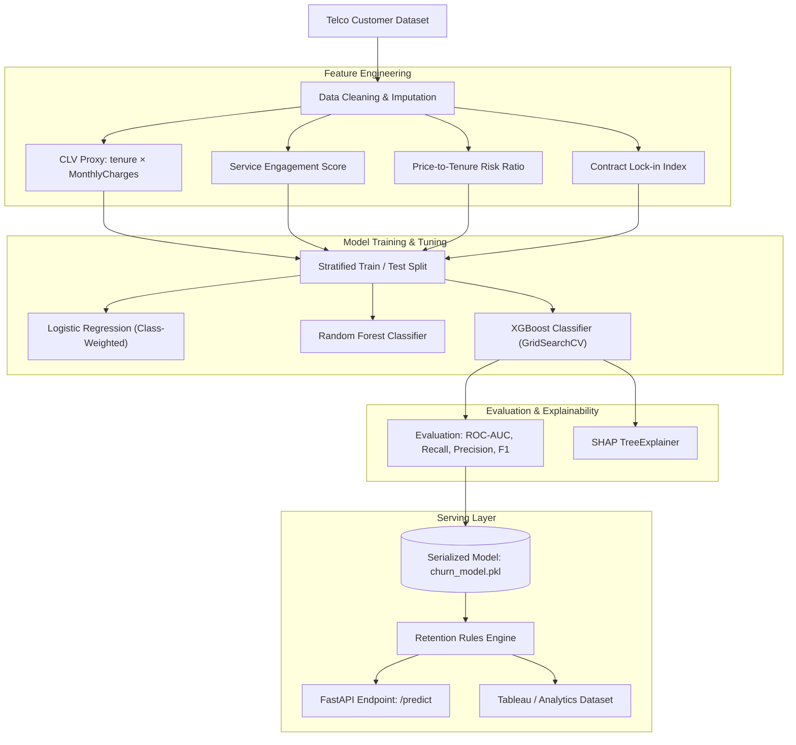

# Customer Churn Intelligence System

> Predictive machine learning pipeline with XGBoost, SHAP interpretability, automated retention strategy routing, and FastAPI serving.

[](https://www.python.org/)
[](https://fastapi.tiangolo.com/)
[](https://scikit-learn.org/)
[](https://xgboost.readthedocs.io/)
[](https://shap.readthedocs.io/)
[](https://pandas.pydata.org/)

---

## Overview

Most churn projects stop at fitting a default classifier in a Jupyter notebook and reporting vanity accuracy. On imbalanced churn datasets (15–25% churn), a naive model predicting zero churn gets 80%+ accuracy while letting all at-risk customers leave.

I built this project to simulate an end-to-end production ML workflow:
- **Cost-Sensitive Evaluation**: Evaluating against ROC-AUC and Recall rather than naive accuracy.
- **Model Explainability**: Integrating SHAP values to identify why a customer is flagged for churn.
- **Actionable Retention Layer**: Mapping predicted probabilities directly into automated retention recommendations.
- **REST Serving**: Packaging the model behind a FastAPI inference endpoint.

---

## Pipeline Architecture



---

## Key Highlights

- **Engineered Domain Features**: Created custom signals including Customer Lifetime Value (CLV) proxy, multi-service adoption score, and contract stability weight.
- **Model Comparison**: Benchmarked Logistic Regression, Random Forest, and tuned XGBoost with stratified cross-validation.
- **SHAP Feature Attribution**: Surfaces primary macro churn drivers (month-to-month contracts, lack of tech support, fiber-optic pricing friction) for business visibility.
- **Retention Strategy Rules**: Maps probability buckets to practical retention interventions (e.g., annual contract migration discounts for short-tenure month-to-month accounts).

---

## Project Structure

```text
customer-churn-intelligence/
├── api/
│   └── app.py                  # FastAPI REST endpoints (/predict, /health)
├── data/
│   ├── raw/                    # Raw Telco CSV data
│   └── processed/              # Preprocessed datasets
├── notebooks/
│   └── exploratory_analysis.ipynb # EDA & feature distributions
├── src/
│   ├── data_processing.py      # Imputation, encoding, train/test split
│   ├── feature_engineering.py  # Domain feature calculation
│   ├── train_model.py          # GridSearchCV tuning and model export
│   ├── evaluate_model.py       # ROC curves, confusion matrices, SHAP
│   ├── predict.py              # Inference pipeline
│   └── pipeline.py             # Reproducible pipeline runner
└── requirements.txt
```

---

## Quickstart

### 1. Setup Environment
```bash
git clone https://github.com/V-Rytham/Customer-churn-intelligence.git
cd Customer-churn-intelligence

python -m venv .venv
# Windows:
.venv\Scripts\Activate.ps1
# Linux/macOS:
# source .venv/bin/activate

pip install -r requirements.txt
```

### 2. Run Training Pipeline
```bash
python -m src.pipeline
```

### 3. Launch Prediction API
```bash
uvicorn api.app:app --host 0.0.0.0 --port 8000 --reload
```
Interactive docs available at `http://localhost:8000/docs`.

### 4. Sample Prediction Request
```bash
curl -X POST http://localhost:8000/predict \
  -H "Content-Type: application/json" \
  -d '{
    "gender": "Female",
    "SeniorCitizen": 0,
    "Partner": "No",
    "Dependents": "No",
    "tenure": 3,
    "PhoneService": "Yes",
    "MultipleLines": "No",
    "InternetService": "Fiber optic",
    "OnlineSecurity": "No",
    "OnlineBackup": "No",
    "DeviceProtection": "No",
    "TechSupport": "No",
    "StreamingTV": "Yes",
    "StreamingMovies": "Yes",
    "Contract": "Month-to-month",
    "PaperlessBilling": "Yes",
    "PaymentMethod": "Electronic check",
    "MonthlyCharges": 95.5,
    "TotalCharges": 260.0
  }'
```
